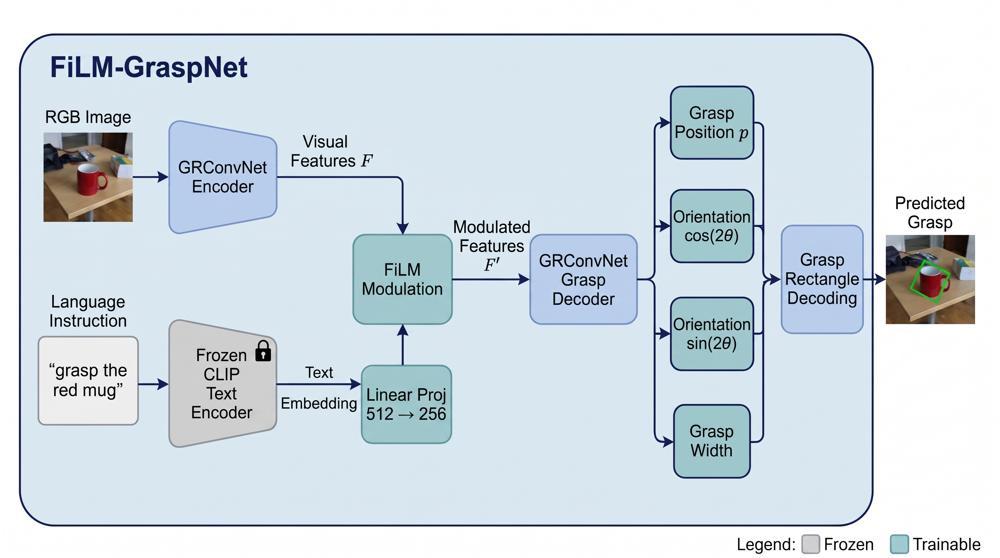
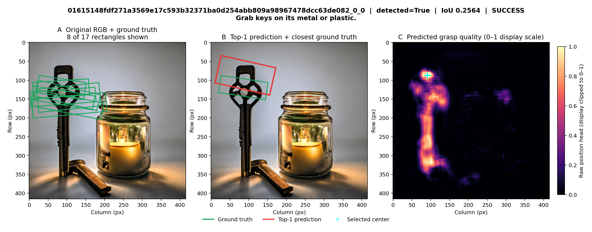
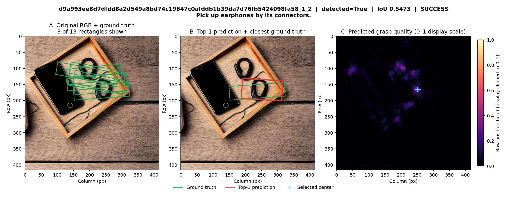

# FiLM-GraspNet: Language-Conditioned Grasp Detection with Grasp-Aware Loss

<p align="center">
  
</p>

**Overview:** FiLM-GraspNet combines a pretrained RGB **GR-ConvNet** backbone with a
frozen **CLIP** text encoder. Language embeddings modulate visual features via
FiLM, while the A2 model uses a **Grasp-Aware Geometric Loss** to focus grasp
geometry learning on valid grasp regions.

## Table of Contents

- [Highlights](#highlights)
- [Architecture](#architecture)
- [Model A2 Qualitative Results](#model-a2-film-graspnet-with-grasp-aware-geometric-loss-qualitative-results)
- [Dataset](#dataset)
- [Setup](#setup)
- [Training](#training)
- [Evaluation](#evaluation)
- [Project Structure](#project-structure)
- [Acknowledgments](#acknowledgments)

---

## Highlights

- Language-conditioned grasp prediction from an RGB image and instruction.
- End-to-end fine-tuning of GR-ConvNet and FiLM; CLIP remains frozen.
- Four dense outputs: grasp quality, `cos(2θ)`, `sin(2θ)`, and grasp width.
- Versioned B0, A1, and A2 experiment configurations.
- Reproducible checkpoint, dataset provenance, and evaluation checks.

## Architecture

FiLM-GraspNet encodes the RGB image with GR-ConvNet and the instruction with
CLIP ViT-B/32. FiLM applies the text condition at the visual bottleneck before
the GR-ConvNet decoder predicts the four grasp maps.

## Model A2 (FiLM-GraspNet with Grasp-Aware Geometric Loss) Qualitative Results

Green rectangles are ground truth, red is the top-1 prediction, and the final
panel shows the predicted grasp-quality map.

<p align="center">
  
</p>

<p align="center">
  
</p>

## Dataset

The project combines two remote datasets published by AIRV Lab on Hugging
Face:

- [Grasp-Anything](https://huggingface.co/datasets/airvlab/Grasp-Anything)
  provides the `416 × 416` RGB scene images. Each scene is identified by a
  SHA-256 filename.
- [Grasp-Anything++](https://huggingface.co/datasets/airvlab/Grasp-Anything-pp)
  provides language grasp instructions and positive grasp annotations for
  object parts.

Dataset preparation scripts match the RGB scenes with their instructions and
positive grasp labels, then create deterministic manifest-based train and
validation subsets:

```text
storage/data/
├── train_pilot/
│   ├── images/
│   ├── grasps/
│   └── manifest.json
└── val_pilot/
    ├── images/
    ├── grasps/
    └── manifest.json
```

The remote preparation utilities are described in
[`scripts/README.md`](scripts/README.md). Official split definitions are in
`splits/grasp-anything-pp/`. The datasets are stored outside this repo under
`../storage/data/`.

## Setup

Use Python 3.9 for the pinned dependencies in `requirements.txt`.

```bash
git clone https://github.com/nammannam/film-graspnet.git
cd film-graspnet

conda create --name filmgrasp39 python=3.9 -y
conda activate filmgrasp39
python -m pip install -e .
python -m pip install -r requirements.txt
```

## Training

Train the A2 model with Dropout and Grasp-Aware Geometric Loss:

The pilot manifests must exist at `../storage/data/train_pilot/` and
`../storage/data/val_pilot/`, and the GR-ConvNet weights must exist at
`checkpoints/grconvnet3_pretrained.pth`. See
[`scripts/README.md`](scripts/README.md) to prepare these inputs. The configs
request CUDA; use `--device cpu` if CUDA is unavailable.

```bash
python -m filmgrasp.training.train \
  --config configs/pilot_a2_masked_geometry.json
```

Available configurations:

- `configs/pilot_b0.json`: baseline loss, no Dropout.
- `configs/pilot_a1_dropout.json`: baseline loss with Dropout.
- `configs/pilot_a2_masked_geometry.json`: Dropout with Grasp-Aware Geometric Loss.

## Evaluation

```bash
python -m filmgrasp.evaluation.evaluate_checkpoint \
  --run-dir runs/<run-name> \
  --checkpoint best \
  --dataset validation=../storage/data/val_pilot \
  --pretrained checkpoints/grconvnet3_pretrained.pth \
  --device cpu \
  --visualize \
  --visualization-dir runs/<run-name>/visualizations/readme
```

A prediction is successful when its maximum grasp IoU is strictly greater
than `0.25`.

## Project Structure

```text
film-graspnet/
├── configs/      # Versioned experiment configurations
├── figures/      # Architecture and qualitative examples
├── scripts/      # Dataset, audit, provenance, and smoke-test utilities
├── splits/       # Grasp-Anything++ split definitions
└── src/filmgrasp/
    ├── data/
    ├── evaluation/
    ├── geometry/
    ├── models/
    └── training/
```

## Acknowledgments

This project builds on **Grasp-Anything**, **Grasp-Anything++**, **GR-ConvNet**,
**LGD**, and OpenAI **CLIP**.
